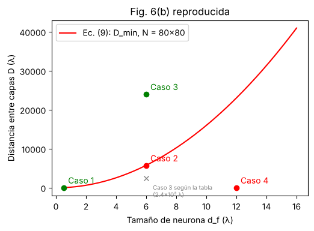
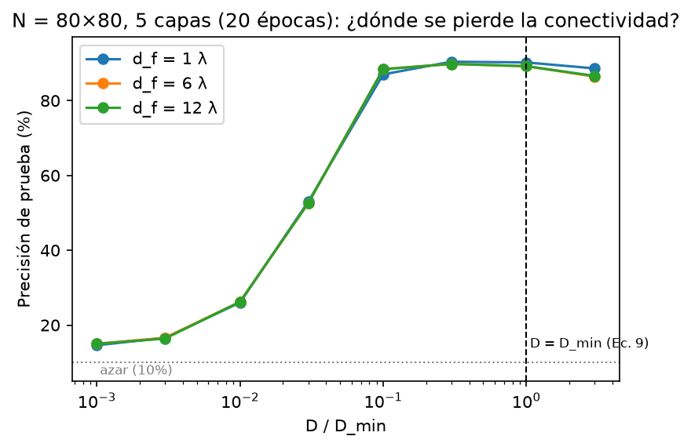
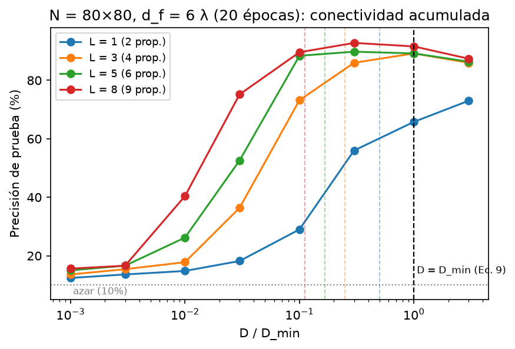
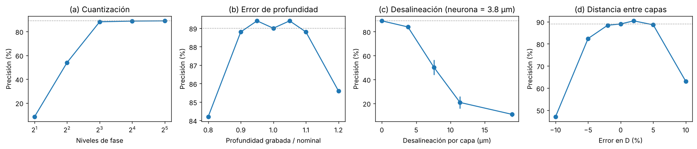
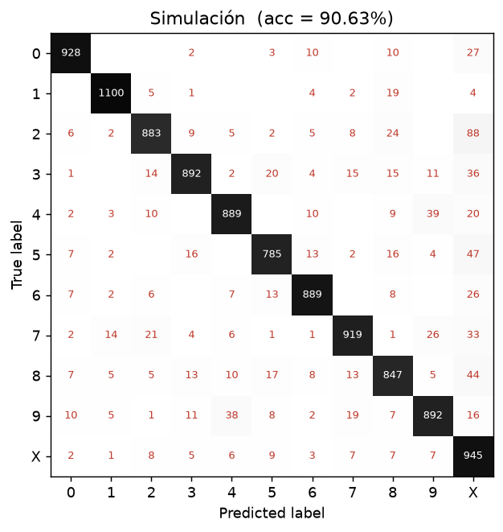
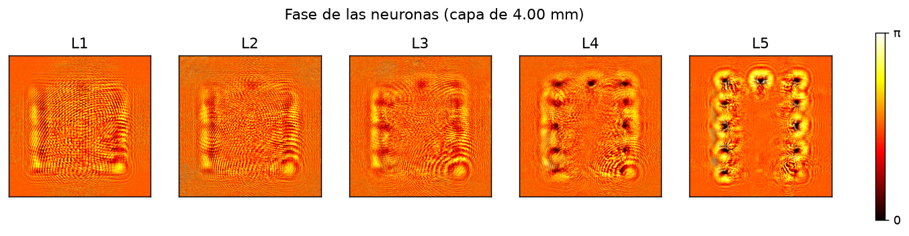
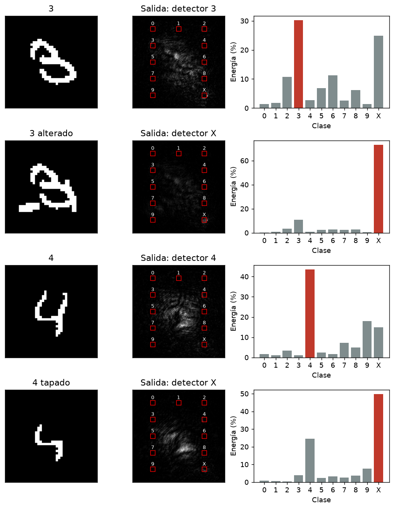
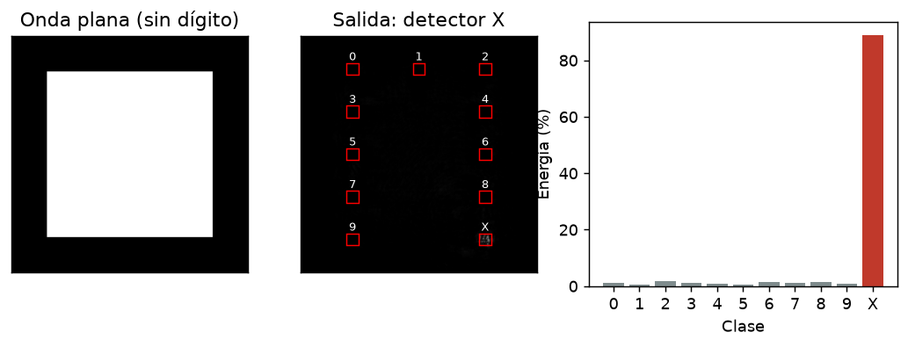
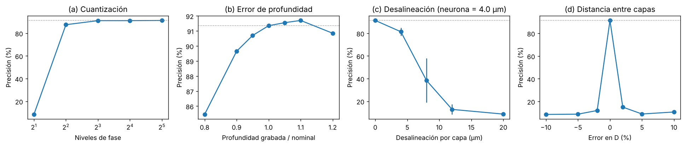

# Redes neuronales difractivas en el visible ($\text{D}^2\text{NN}$)

Reproducción numérica, análisis teórico desde la difracción escalar y material del proyecto final de Óptica basados en:

> H. Chen, J. Feng, M. Jiang, Y. Wang, J. Lin, J. Tan, P. Jin,
> *Diffractive Deep Neural Networks at Visible Wavelengths*,
> **Engineering 7 (2021) 1483–1491**. doi:10.1016/j.eng.2020.07.032

Una $\text{D}^2\text{NN}$ es una pila de máscaras de **solo fase** ($\Phi \in [0,\pi]$) separadas por propagación libre. Cada píxel de cada máscara es una «neurona» y la difracción conecta las neuronas de capas vecinas. Se entrena por retropropagación a través del modelo de difracción para que la luz de un dígito escrito a mano termine concentrada en el detector de su clase.

Todo el modelo físico parte de la óptica escalar de Fourier: integral de Rayleigh–Sommerfeld, espectro angular de ondas planas (Ecs. 1–5 del artículo) y ángulo máximo de difracción de una neurona (Ecs. 6–9).

---

## Documentos del proyecto

- **Tesina (LaTeX + PDF):** [`tesina/main.pdf`](tesina/main.pdf) — deducciones completas desde Maxwell/Helmholtz hasta el criterio de conectividad, gradiente por cálculo de Wirtinger, validación numérica, resultados y apéndices.
- **Presentación (15 min, Beamer PDF + HTML interactiva):** [`presentacion/presentacion.pdf`](presentacion/presentacion.pdf) y [`presentacion/presentacion.html`](presentacion/presentacion.html).

---

## Resultados y hallazgos principales

### 1. Validación del propagador — `scripts/01_validate_optics.py`

| Prueba | Referencia | Error máx. |
|---|---|---|
| Apertura cuadrada 200 µm, $z = 8\text{ mm}$ ($N_F \approx 2$) | Fresnel analítica (integrales de Fresnel) | **0.04 %** |
| Apertura circular $a = 40\text{ }\mu\text{m}$, campo en el eje | R–S exacta: $U = e^{jkz} - \frac{z}{R}e^{jkR}$ | **3.6 %** ($z \ge 0.3\text{ mm}$)¹ |
| Fase aleatoria, neuronas de 4 µm, $z = 1\text{--}20\,z_c$ | R–S por suma directa | **3.5–9.1 %** (banda limitada) vs. 22–99 % (ingenuo) |

¹ Más cerca, el borde escalonado del círculo pixelado domina el error; no es un problema del propagador.


**Por qué importa:** con los parámetros del artículo ($N = 1000\times 1000$, $\Delta x = 4\text{ }\mu\text{m}$, relleno $2\times$), el sistema opera en campo cercano ($N_F \approx 126$) y fuera del rango de validez de la aproximación de Fresnel (el término despreciado en $\rho^4$ alcanza $2.4\text{ rad}$ en los ejes y $9.7\text{ rad}$ en la diagonal). Además, el espectro angular «ingenuo» deja de estar bien muestreado a partir de $z_c = 50.4\text{ mm}$ ($z_c \approx N_p\Delta x^2/\lambda = 50.6\text{ mm}$), justo en $D \approx 50\text{ mm}$. Por eso todo el código usa el **espectro angular de banda limitada** (Matsushima & Shimobaba, *Opt. Express* 17, 19662, 2009).

### 2. Identidad: la Ec. 9 del paper *es* la condición de muestreo del espectro angular

La condición de conectividad total del artículo (Ec. 9) exige que el cono controlable de cada neurona, $\sin\varphi_{\max} = \lambda/(2d_f)$ (frecuencia de Nyquist de la malla periódica de neuronas, no el primer cero de la función $\operatorname{sinc}$), cubra toda la capa siguiente de lado $w = \sqrt{N}\,d_f$:

$$D \;\ge\; D_{\min} \equiv \sqrt{N}\,d_f\,\sqrt{\frac{4d_f^2}{\lambda^2}-1}.$$

Sobre una ventana con relleno $2\times$ ($N_p = 2\sqrt{N}$), el límite de banda de Matsushima & Shimobaba conserva las frecuencias

$$|u|, |v| \le f_{\lim} = \frac{1}{\lambda\sqrt{(2\Delta u\,z)^2 + 1}}, \qquad \Delta u = \frac{1}{2w}.$$

Al imponer $f_{\lim} = 1/(2d_f)$ se obtiene **$D_{\min} \equiv z_c$** de forma exacta. `scripts/01_validate_optics.py` lo verifica numéricamente para 15 combinaciones de $(\sqrt{N}, d_f)$: el cociente $f_{\lim}(D_{\min})\cdot 2d_f$ da **1.000000** en todas (`results/01_optics/summary.json`).

Para el sistema del artículo: $\varphi_{\max} = 4.54^\circ$, $D_{\min} = \mathbf{50.4\text{ mm}}$ (usan $\approx 5\text{ cm}$).

### 3. Escalamiento por el número de Fresnel de una neurona ($N_{F,n}$)

En el régimen paraxial ($d_f \gg \lambda$), el factor de propagación discreto con frecuencias $u = m/(N_p d_f)$ depende únicamente de $\sqrt{N}$, $L$ y el **número de Fresnel de una neurona**:

$$N_{F,n} \equiv \frac{d_f^2}{\lambda D}, \qquad \frac{D}{D_{\min}} \approx \frac{1}{2\sqrt{N}\,N_{F,n}}.$$

Dos redes con iguales $\sqrt{N}$, $L$ y $N_{F,n}$ son ópticamente equivalentes. Físicamente, $N_{F,n}$ cuenta cuántas zonas de Fresnel abarca una neurona vista desde la capa siguiente: si $N_{F,n} \gg 1$ (régimen geométrico), la luz casi no se difracta y cada neurona sólo ilumina a su vecina.

### 4. Gradiente por cálculo de Wirtinger e interpretación holográfica — `scripts/07_check_gradient.py`

Derivando $\partial \mathcal{L}/\partial \Phi_i^l$ con cálculo de Wirtinger ($G \equiv \partial \mathcal{L}/\partial Y^*$), el operador adjunto de propagación libre conjuga la función de transferencia ($\mathcal{P}_D^\dagger = \mathcal{P}_{-D}$, usando $H^*(u,v;D) = H(u,v;-D)$ para ondas propagantes): el error viaja como una onda invertida hacia atrás por el sistema. En cada capa $l$, el gradiente es un **término de interferencia holográfica** entre la onda incidente $W^l$ y la onda de error $G^{W,l}$:

$$\frac{\partial \mathcal{L}}{\partial \Phi_i^l} = 2\,\operatorname{Im}\!\left\{G_i^{W,l}\,(W_i^l)^*\right\}.$$

`scripts/07_check_gradient.py` implementa los pasos 1 a 5 a mano en doble precisión (`float64`/`complex128`, red $32\times 32$ de 5 capas) y verifica la igualdad frente a `autograd` de PyTorch al nivel del redondeo de máquina (`results/01_optics/gradient_check.json`):

| Capa 1 | Capa 2 | Capa 3 | Capa 4 | Capa 5 | Total |
|---|---|---|---|---|---|
| 4.90e-16 | 5.31e-16 | 5.10e-16 | 4.79e-16 | 3.43e-16 | **4.49e-16** |

### 5. Fig. 6 reproducida ($N = 80\times 80$, 5 capas, 10 clases) — `scripts/02_fig6_cases.py`

10 000 imágenes de entrenamiento, 500 de prueba, Adam ($\text{lr} = 10^{-3}$), 20 épocas:

| Caso | $d_f$ ($\lambda$) | $D$ ($\lambda$) | $D_{\min}$ Ec. 9 ($\lambda$) | $D/D_{\min}$ | Paper (%) | Este trabajo (%) |
|---|---|---|---|---|---|---|
| 1 | 0.53 | 15 | 14.9 | 1.01 | 90.0 | **89.8** |
| 2 | 6.00 | $5.7\times 10^3$ | $5.74\times 10^3$ | 0.99 | 91.0 | **89.0** |
| 3 (gráfica 6b) | 6.00 | $2.4\times 10^4$ | $5.74\times 10^3$ | 4.18 | 91.2 | 84.8 |
| 3 (tabla 6c) | 6.00 | $2.4\times 10^3$ | $5.74\times 10^3$ | 0.42 | 91.2 | **91.2** |
| 4 | 12.00 | 15 | $2.3\times 10^4$ | 0.0007 | «~0.1» | **14.4** ($\approx$ azar) |



**Inconsistencias encontradas en el artículo:**
1. **Caso 3:** La tabla 6(c) indica $D \approx 2.4\times 10^3\lambda$ (debajo de la curva) y ahí reproducimos exactamente **91.2 %**; con el valor dibujado en la Fig. 6(b) ($2.4\times 10^4\lambda$) baja a **84.8 %** porque la luz se fuga por los bordes de la apertura finita.
2. **Caso 4:** «~0.1 %» es imposible con 10 clases (azar = 10 %); debe leerse como fracción $0.1$. Con $\varphi_{\max}=2.39^\circ$ y $D=15\lambda$, el cono apenas se desplaza $R \approx 0.6\lambda < d_f$, y una máscara de solo fase no cambia la intensidad local.

### 6. Barrido de conectividad y conectividad acumulada ($L = 1, 3, 5, 8$) — `scripts/03_connectivity_sweep.py`




**Barrido por tamaño de neurona ($L = 5$, 20 épocas):**

| $D/D_{\min}$ | 0.001 | 0.003 | 0.01 | 0.03 | 0.1 | 0.3 | 1 | 3 |
|---|---|---|---|---|---|---|---|---|
| $d_f = 1\lambda$ (%) | 14.6 | 16.6 | 26.0 | 53.0 | 87.0 | **90.4** | 90.2 | 88.6 |
| $d_f = 6\lambda$ (%) | 15.0 | 16.6 | 26.2 | 52.6 | 88.4 | **89.8** | 89.2 | 86.4 |
| $d_f = 12\lambda$ (%) | 15.0 | 16.4 | 26.2 | 52.6 | 88.4 | **89.8** | 89.2 | 86.6 |

**Barrido por número de capas ($d_f = 6\lambda$, 20 épocas):**

| Capas $L$ ($L+1$ prop.) | $1/(L+1)$ | 0.001 | 0.003 | 0.01 | 0.03 | 0.1 | 0.3 | 1 | 3 |
|---|---|---|---|---|---|---|---|---|---|
| $L = 1$ (2 prop.) | 0.500 | 12.4 | 13.6 | 14.8 | 18.2 | 29.0 | 56.0 | 65.8 | 73.0 |
| $L = 3$ (4 prop.) | 0.250 | 13.6 | 15.4 | 17.8 | 36.4 | 73.2 | 86.0 | **89.2** | 86.0 |
| $L = 5$ (6 prop.) | 0.167 | 15.0 | 16.6 | 26.2 | 52.6 | 88.4 | **89.8** | 89.2 | 86.4 |
| $L = 8$ (9 prop.) | 0.111 | 15.6 | 16.6 | 40.4 | 75.2 | 89.6 | **92.8** | 91.6 | 87.4 |

- Las curvas para $6\lambda$ y $12\lambda$ coinciden prácticamente punto a punto, validando el escalamiento por $N_{F,n}$.
- La transición real ocurre entre $0.03$ y $0.1\,D_{\min}$ (88.4 % ya en $0.1\,D_{\min}$): la Ec. 9 es $\sim 10\times$ más estricta de lo necesario porque la conectividad se acumula en $L+1$ propagaciones, como confirma el desplazamiento sistemático hacia la izquierda al aumentar $L$ de $1$ a $8$ (de 18.2 % a 75.2 % en $0.03\,D_{\min}$).
- Con $L=1$, aun en $D \ge D_{\min}$ la precisión se estanca en 65.8–73.0 % por baja capacidad expresiva; con $L \ge 3$ en $D = 3\,D_{\min}$ cae por fuga de luz en aperturas finitas.

### 7. Tolerancias de fabricación (modelo del caso 2, neuronas de 3.8 µm) — `scripts/06_fabrication_errors.py`



- **Cuantización:** 2 niveles $\to 8.4\%$, 4 $\to 54.0\%$, **8 $\to 88.2\%$**, 16 $\to 88.8\%$. Hacen falta al menos 3 pasos de litografía (8 niveles).
- **Profundidad de grabado:** $\pm 10\%$ mantiene $\ge 88.8\%$; $\pm 20\%$ baja a $84.2\text{--}85.6\%$.
- **Desalineación lateral (neuronas enteras, $d_f = 3.8\,\mu\text{m}$, base 89.0 %):** **1 neurona $\to 83.9\%$**, 2 neuronas $\to 50.1\%$, 3 neuronas $\to 20.8\%$, 5 neuronas $\to 10.8\%$; una sola neurona de desalineación reproduce el $84\%$ experimental del artículo.
- **Distancia entre capas:** $\pm 5\% \to \ge 82.4\%$; $-10\% \to 47.0\%$.

### 8. Sistema completo ($1000\times 1000$ neuronas, 11 clases) en GPU — `scripts/04_train_full.py`

Entrenado en **NVIDIA GeForce RTX 5060 Ti (16 GiB, `sm_120`)** con `--epochs 6 --bs 24` ($20\,004$ pasos de Adam sobre $80\,000$ imágenes, malla $2000\times 2000$ en `complex64`, $7.03\text{ GiB}$ VRAM pico, $20.32\text{ ms/imagen}$, **2 h 56 min** totales):

| Métrica (11 000 imágenes de prueba) | Artículo (20 épocas) | Este trabajo (6 épocas) |
|---|---|---|
| Precisión total (11 clases) | 91.57 % | **90.63 %** |
| Dígitos sin cambio (0–9, 10 000 imgs.) | — | **90.24 %** |
| Clase X (tapados o alterados, 1 000 imgs.) | — | **94.50 %** |
| Tiempo de entrenamiento | $\approx 20\text{ h}$ (GTX 1080) | **2.93 h** (RTX 5060 Ti) |







- **Tolerancias en $1000\times 1000$ (2 000 imágenes, base ideal = 91.35 %):** 8 niveles de fase conservan **91.05 %** (4 niveles: 87.50 %) y $\pm 10\%$ de profundidad mantiene **89.65–91.70 %**. En alineación lateral ($d_f = 4\,\mu\text{m}$): **1 neurona $\to 81.4 \pm 3.5\%$**, 2 neuronas $\to 38.4 \pm 19.5\%$, 3 neuronas $\to 12.8 \pm 4.4\%$, 5 neuronas $\to 8.7\%$. En distancia axial, variar $D = 50\text{ mm}$ en $\pm 2\%$ ($\pm 1\text{ mm}$) cae a **12.05–15.05 %** porque la tolerancia axial es $\Delta D \le 2d_f^2/\lambda \approx 50.6\,\mu\text{m}$, es decir **0.10 % de $D$** (frente a 1.3 % en el caso 2), ya que la tolerancia relativa escala como $1/\sqrt{N}$.
- **Eficiencia de detección ($\eta$):** con la pérdida relativa original solo el **1.1 %** de la luz de salida llega a los detectores en $1000^2$ (**1.6 %** en el caso 2). Con `--efficiency-weight 3` en el caso 2, la eficiencia sube **11×** (**1.6 % $\to$ 18.6 %**) a cambio de ~3 puntos de precisión (89.0 % $\to$ 85.8 %).

---

## Decisiones que el artículo no especifica

| Aspecto | Elección aquí | Dónde cambiarlo |
|---|---|---|
| Propagador | Espectro angular **de banda limitada**, relleno $2\times$, cálculo de $H$ en `float64` | `d2nn/optics.py` |
| Tamaño finito de las capas | El campo se recorta a $w\times w$ después de cada propagación | `AngularSpectrum` |
| Distancia entrada$\to L_1$ y $L_5\to$salida | Igual a $D$ | `Config.distances` |
| Codificación de la entrada | MNIST escalado con vecino más cercano al 70 % del lado, binarizado | `Encoder` |
| Detectores | 11 cuadrados del 5 % del lado (Fig. 3b); 10 en arreglo 3–4–3 del 8 % para Fig. 6 | `detector_boxes` |
| Pérdida | Softmax-cross-entropy sobre $T\cdot E_k/\sum E$ (energía relativa, $T=10$) | `D2NN.logits` |
| Fase | $\Phi = \pi\,\sigma(\theta)\in [0,\pi]$, $\theta$ inicial $\sim \mathcal{N}(0, 0.1^2)$ | `D2NN.phases` |
| Dígitos «cambiados» (clase X) | 50 % tapados (borra 25–65 % del trazo), 50 % alterados (2–3 trazos extra) | `d2nn/data.py` |

---

## Cómo correrlo

Requisitos: Python $\ge 3.10$, PyTorch, NumPy, SciPy, Matplotlib y pytest (MNIST se descarga automáticamente en `data/` la primera vez).

```bash
pip install -r requirements.txt
```

Pruebas unitarias y comprobación del gradiente analítico:

```bash
python -m pytest -q tests
python scripts/07_check_gradient.py
```

Validación óptica, Fig. 6 y barrido de conectividad:

```bash
python scripts/01_validate_optics.py
python scripts/02_fig6_cases.py --device cuda
python scripts/03_connectivity_sweep.py --device cuda --epochs 20
```

Evaluación, figuras de análisis y tolerancias de fabricación (p. ej. sobre el caso 2):

```bash
python scripts/05_evaluate.py results/02_fig6/fig6_case2/model.pt
python scripts/06_fabrication_errors.py results/02_fig6/fig6_case2/model.pt
```

Sistema completo ($1000\times 1000$ neuronas, 11 clases — requiere GPU):

```bash
python scripts/benchmark.py --n 1000 --bs 24
python scripts/04_train_full.py --epochs 6 --bs 24 --max-minutes 185
python scripts/05_evaluate.py results/04_full/paper_full/model.pt --bs 24
python scripts/06_fabrication_errors.py results/04_full/paper_full/model.pt --bs 24
```

Para compilar la tesina o la presentación (requiere `pdflatex` + `biber`):

```bash
cd tesina && latexmk -pdf main.tex
cd ../presentacion && latexmk -pdf presentacion.tex
```

---

## Estructura

```
d2nn/
  optics.py    espectro angular (con y sin banda limitada), R-S directo, soluciones
               analíticas, Ec. 6–9
  model.py     D2NN de solo fase, detectores
  data.py      MNIST, dígitos tapados/alterados, codificación en amplitud
  config.py    sistema completo del paper y casos de la Fig. 6
  train.py     entrenamiento, evaluación, guardado/carga
  viz.py       figuras al estilo del paper
scripts/
  01_validate_optics.py    validación del propagador, Ec. 9 y f_lim
  02_fig6_cases.py         Fig. 6 (casos 1–4)
  03_connectivity_sweep.py barrido de D/D_min
  04_train_full.py         sistema completo (1000×1000, 11 clases)
  05_evaluate.py           Fig. 1b, 2a, 3, 4, 5 y corte x-z
  06_fabrication_errors.py tolerancias de fabricación
  07_check_gradient.py     verificación del gradiente de Wirtinger vs. autograd
  benchmark.py             tiempo/memoria por iteración
tests/                     pruebas unitarias (pytest)
results/                   resultados generados y modelos entrenados
tesina/                    código fuente LaTeX y PDF compilado de la tesina
presentacion/              diapositivas Beamer (PDF) y presentación interactiva HTML
```
