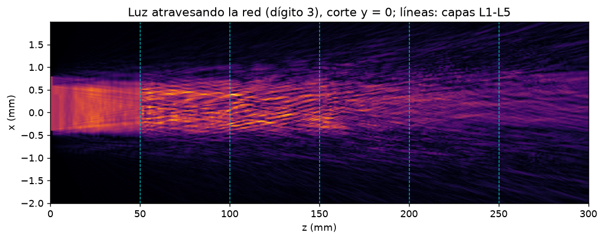
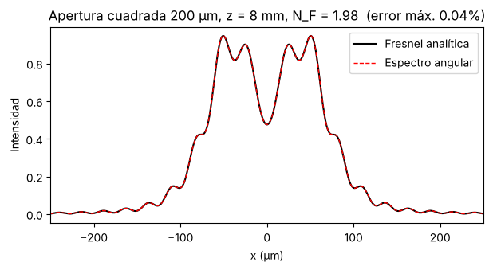
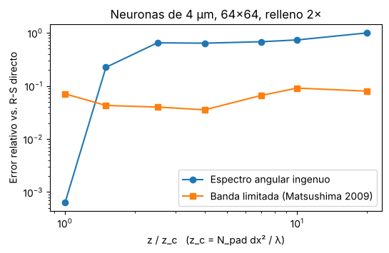

<div align="center">

# Redes Neuronales Difractivas en el Visible ($\text{D}^2\text{NN}$)

**Fundamentos de difracción escalar, criterio de conectividad y reproducción numérica de Chen et al. (*Engineering* 7, 2021)**

[Tesina (PDF)](tesina/main.pdf) · [Presentación Web](https://angelgab3.github.io/Final_Project_Optics_Difractive_Neural_Networks/) · [Presentación Beamer (PDF)](presentacion/presentacion.pdf) · [Resultados detallados](results/README.md)

<br>



<p><i>Corte longitudinal x–z del frente de onda (He–Ne, 632.8 nm) atravesando 5 placas de fase de 1000 × 1000 neuronas a lo largo de 300 mm.</i></p>

</div>

---

## Resumen del proyecto

Una red neuronal difractiva profunda ($\text{D}^2\text{NN}$) clasifica imágenes de forma completamente óptica mediante una pila de máscaras de **solo fase** ($\Phi \in [0,\pi]$) separadas por propagación en el espacio libre. Este repositorio contiene el simulador en PyTorch, los experimentos numéricos, la tesina en LaTeX (55 páginas) y las presentaciones del proyecto final de Óptica.

* **Autores:** Alonso Hernández Hernández y Ángel Gabriel Munguía Velázquez (Universidad de las Américas Puebla)
* **Artículo de referencia:** H. Chen et al., *Diffractive Deep Neural Networks at Visible Wavelengths*, *Engineering* 7 (2021) 1483–1491 (`doi:10.1016/j.eng.2020.07.032`)
* **Sistema físico:** láser He–Ne ($\lambda = 632.8\text{ nm}$), 5 placas de sílice fundida de $1000\times 1000$ neuronas ($d_f = 4\,\mu\text{m}$, $w = 4\text{ mm}$), separación $D = 50\text{ mm}$ ($N_F \approx 126$)
* **Propagador:** espectro angular de banda limitada (Matsushima & Shimobaba, 2009) con relleno $2\times$ y función de transferencia $H$ en `float64`
* **Entorno de cómputo:** Python $\ge 3.10$, PyTorch + CUDA 12.8 sobre NVIDIA GeForce RTX 5060 Ti (`16 GiB` VRAM, `7.03 GiB` pico)
* **Resultados clave:** **90.63 %** en prueba en $1000\times 1000$ (**94.50 %** en clase X), gradiente de Wirtinger verificado a **$4.49\times 10^{-16}$** frente a `autograd`, e identidad exacta $D_{\min} \equiv z_c$

---

## Galería de resultados

### Validación del propagador óptico

Comparación de `AngularSpectrum` frente a la solución analítica de Fresnel en apertura cuadrada (**0.04 %** de error máximo) y frente a la integral de Rayleigh--Sommerfeld por suma directa para evitar *aliasing* más allá de $z_c$.

<table align="center">
  <tr>
    <td width="50%" align="center">
      <b>Apertura cuadrada vs. Fresnel analítica</b><br>
      
    </td>
    <td width="50%" align="center">
      <b>Espectro angular ingenuo vs. banda limitada</b><br>
      
    </td>
  </tr>
</table>

### Conectividad entre capas y escalamiento

El colapso de las curvas para $d_f \in \{6\lambda, 12\lambda\}$ demuestra el escalamiento por el número de Fresnel de una neurona ($N_{F,n} = d_f^2/(\lambda D)$), mientras que variar $L \in \{1, 3, 5, 8\}$ confirma que la conectividad se acumula en $L+1$ etapas ($\sim 0.1\,D_{\min}$ para 5 capas).

<table align="center">
  <tr>
    <td width="50%" align="center">
      <b>Barrido en D / D_min por tamaño de neurona</b><br>
      
    </td>
    <td width="50%" align="center">
      <b>Conectividad acumulada por número de capas</b><br>
      
    </td>
  </tr>
</table>

### Sistema completo (1000 × 1000 neuronas, 11 clases)

Entrenamiento completo en GPU (80 000 imágenes de entrenamiento, 11 000 de prueba, 6 épocas en 2.93 h). Las primeras capas desvían frecuencias y la última capa (`L5`) organiza 11 microlentes difractivas en la geometría de los detectores.

<div align="center">
  
</div>

<table align="center">
  <tr>
    <td width="46%" align="center">
      <b>Matriz de confusión (90.63 % global)</b><br>
      
    </td>
    <td width="54%" align="center">
      <b>Clasificación e identificación de clase X</b><br>
      
    </td>
  </tr>
</table>

### Tolerancias de fabricación y montaje

Evaluación sin reentrenar ante cuantización discreta, error de profundidad de grabado, desalineación lateral y separación axial ($\Delta D/D \propto 1/\sqrt{N}$, apenas `0.10 %` en $1000\times 1000$).

<div align="center">
  
</div>

---

## Documentación y estructura del repositorio

Para mantener la documentación ordenada, cada subcarpeta contiene su propio `README.md` con el detalle técnico correspondiente:

| Ruta | Contenido | Documentación |
| :--- | :--- | :--- |
| `d2nn/` | Paquete fuente en PyTorch: óptica escalar, modelo `D2NN`, datos, entrenamiento y gráficas | [`d2nn/README.md`](d2nn/README.md) |
| `scripts/` | Scripts de validación, Fig. 6, barridos en GPU, entrenamiento $1000^2$, gradiente y benchmark | [`scripts/README.md`](scripts/README.md) |
| `results/` | Tablas completas, métricas JSON, modelos entrenados y figuras de los 4 bloques experimentales | [`results/README.md`](results/README.md) |
| `tesina/` | Código fuente LaTeX y documento compilado ([`tesina/main.pdf`](tesina/main.pdf), 55 páginas) | [`tesina/README.md`](tesina/README.md) |
| `presentacion/` | Diapositivas interactivas HTML/KaTeX ([`presentacion.html`](presentacion/presentacion.html)) y Beamer ([`presentacion.pdf`](presentacion/presentacion.pdf)) | [`presentacion/README.md`](presentacion/README.md) |
| `tests/` | Pruebas unitarias con `pytest` para propagador, identidad $D_{\min}=z_c$ y gradientes | [`tests/test_d2nn.py`](tests/test_d2nn.py) |
| `assets/` | Figuras seleccionadas utilizadas en la portada del repositorio | --- |

---

## Inicio rápido

Requisitos: Python $\ge 3.10$, PyTorch, NumPy, SciPy, Matplotlib y `pytest` (MNIST se descarga automáticamente en `data/` al ejecutar experimentos con datos).

```bash
pip install -r requirements.txt
python -m pytest -q tests
python scripts/07_check_gradient.py
python scripts/01_validate_optics.py
```

Para reproducir los barridos en GPU, el entrenamiento del sistema completo $1000\times 1000$ o el análisis de tolerancias, consulta [`scripts/README.md`](scripts/README.md).
